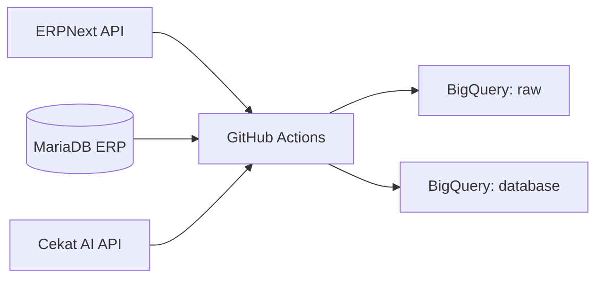

# Euromedica ETL

Kumpulan pipeline ETL untuk memindahkan data operasional Euromedica dari ERPNext, MariaDB ERP, dan Cekat AI ke BigQuery. Semua pipeline dijalankan melalui GitHub Actions.

Repository: [javasalfreda/euromedica](https://github.com/javasalfreda/euromedica)

## Daftar Isi

- [Arsitektur](#arsitektur)
- [Struktur Repository](#struktur-repository)
- [Sumber Data & Tujuan](#sumber-data--tujuan)
- [Katalog Workflow](#katalog-workflow)
- [Katalog Script](#katalog-script)
- [Detail ETL](#detail-etl)
- [Tabel BigQuery](#tabel-bigquery)
- [Environment & Secrets](#environment--secrets)
- [Menjalankan ETL](#menjalankan-etl)
- [Schedule & Timezone](#schedule--timezone)
- [Catatan Operasional](#catatan-operasional)
- [Troubleshooting](#troubleshooting)
- [Catatan Keamanan](#catatan-keamanan)
- [Menambah ETL Baru](#menambah-etl-baru)

## Arsitektur



Komponen utama:

- **GitHub Actions** menjalankan ETL sesuai jadwal atau manual.
- **Tailscale** menghubungkan runner ke MariaDB read-only.
- **Google Service Account** (`GCP_SA_KEY`) dipakai untuk akses BigQuery.
- **BigQuery project**: `euromedica-495509`
- **Dataset**: `raw` dan `database`

## Struktur Repository

```text
.
├── .github/
│   └── workflows/
│       ├── cekat_etl.yml
│       ├── customer_monthly_type_etl.yml
│       ├── erp_etl.yml
│       ├── full_conversation_skin_slim.yml
│       ├── item_wise_sales_etl.yml
│       └── manual_rerun.yml
├── etl_all_boards_cekat.py
├── etl_all_boards_cekat_ehl_esc_esl.py
├── etl_boards_calendar_cekat.py
├── etl_boards_tracker_skin_slim.py
├── etl_boards_tracker_skin_slim_optimized.py
├── etl_conversation_cekat.py
├── etl_customer_monthly_type.py
├── etl_dim_customer.py
├── etl_fact_transaction.py
├── etl_fact_transaction_esc_esl.py
├── etl_item_wise_sales.py
├── etl_messages_cekat_ads.py
├── etl_messages_cekat_ads_v2.py
├── full_conversation_skin_slim.py
└── README.md
```

## Sumber Data & Tujuan

### 1. ERPNext API

Dipakai oleh:

- `etl_fact_transaction.py`
- `etl_fact_transaction_esc_esl.py`
- `etl_dim_customer.py`

Endpoint:

- `POST https://erpeuromedicagroup.com/api/method/login`
- `POST https://erpeuromedicagroup.com/api/method/frappe.desk.query_report.run`
- `GET https://erpeuromedicagroup.com/api/resource/Customer`

Report yang dipakai:

- **Item-wise Sales History**

### 2. MariaDB ERP

Dipakai oleh:

- `etl_item_wise_sales.py`
- `etl_customer_monthly_type.py`

Akses dilakukan via Tailscale menggunakan user read-only. Nama tabel sumber dijelaskan di bagian [Detail ETL](#detail-etl).

### 3. Cekat AI API

Dipakai oleh seluruh script `etl_*_cekat.py`, `etl_messages_cekat_ads*.py`, dan `full_conversation_skin_slim.py`.

Endpoint utama:

- `https://api.cekat.ai/api/crm/boards`
- `https://api.cekat.ai/api/crm/boards/{board_id}/items`
- `https://api.cekat.ai/api/conversations`
- `https://api.cekat.ai/api/messages`

### 4. BigQuery

Semua output akhir berada di:

- `euromedica-495509.raw.*`
- `euromedica-495509.database.*`

## Katalog Workflow

| Workflow | Jadwal | Script | Target utama |
|---|---|---|---|
| [`erp_etl.yml`](.github/workflows/erp_etl.yml) | 19:37 UTC / 02:37 WIB | `etl_fact_transaction.py`, `etl_fact_transaction_esc_esl.py`, `etl_dim_customer.py` | `raw.raw_trx`, `database.fact_transaction`, `raw.raw_trx_esc_esl`, `database.fact_transaction_esc_esl`, `database.dim_customer` |
| [`cekat_etl.yml`](.github/workflows/cekat_etl.yml) | 19:39 UTC / 02:39 WIB | `etl_boards_tracker_skin_slim_optimized.py`, `etl_boards_calendar_cekat.py`, `etl_conversation_cekat.py`, `etl_messages_cekat_ads_v2.py` | `raw.boards_tracker_skin_slim`, `raw.boards_calendar`, `database.conversation`, `raw.ads_cekat` |
| [`full_conversation_skin_slim.yml`](.github/workflows/full_conversation_skin_slim.yml) | 22:00 UTC / 05:00 WIB | `full_conversation_skin_slim.py` | `database.full_conversation_skin_slim` |
| [`item_wise_sales_etl.yml`](.github/workflows/item_wise_sales_etl.yml) | 20:30 UTC / 03:30 WIB | `etl_item_wise_sales.py` | `database.item_wise_sales` |
| [`customer_monthly_type_etl.yml`](.github/workflows/customer_monthly_type_etl.yml) | 20:30 UTC / 03:30 WIB | `etl_customer_monthly_type.py` | `database.customer_monthly_type` |
| [`manual_rerun.yml`](.github/workflows/manual_rerun.yml) | Manual | Pilih satu script atau “Jalankan Semua Script Cekat AI” | Sesuai script |

Catatan:

- Semua cron GitHub Actions memakai **UTC**.

## Katalog Script

| Script | Status | Sumber | Target |
|---|---|---|---|
| `etl_fact_transaction.py` | Scheduled | ERP API report `Item-wise Sales History` (SKIN+ DEI) | `raw.raw_trx` → `database.fact_transaction` |
| `etl_fact_transaction_esc_esl.py` | Scheduled | ERP API report `Item-wise Sales History` (EHL, ESC, ESL) | `raw.raw_trx_esc_esl` → `database.fact_transaction_esc_esl` |
| `etl_dim_customer.py` | Scheduled | ERP API `/api/resource/Customer` | `database.dim_customer` |
| `etl_boards_tracker_skin_slim_optimized.py` | Scheduled | Cekat boards `Tracker SKIN+ New`, `Tracker SLIM+ New` | `raw.boards_tracker_skin_slim` |
| `etl_boards_calendar_cekat.py` | Scheduled | Cekat boards calendar | `raw.boards_calendar` |
| `etl_conversation_cekat.py` | Scheduled | Cekat conversations API | `raw.staging_conversation` → `database.conversation` |
| `etl_messages_cekat_ads_v2.py` | Scheduled | Cekat messages API | `raw.ads_cekat_staging` → `raw.ads_cekat` |
| `full_conversation_skin_slim.py` | Scheduled | Cekat messages API | `database.full_conversation_skin_slim` |
| `etl_item_wise_sales.py` | Scheduled | MariaDB ERP | `database.item_wise_sales` |
| `etl_customer_monthly_type.py` | Scheduled | MariaDB ERP | `database.customer_monthly_type` |
| `etl_all_boards_cekat.py` | Manual/legacy | Cekat boards API | `raw.all_boards_cekat` |
| `etl_all_boards_cekat_ehl_esc_esl.py` | Tidak dipakai workflow | Cekat boards API | `raw.all_boards_cekat_ehl_esc_esl` |
| `etl_boards_tracker_skin_slim.py` | Manual/legacy | Cekat boards API | `raw.boards_tracker_skin_slim` |
| `etl_messages_cekat_ads.py` | Manual/legacy | Cekat messages API | `raw.ads_cekat` |

## Detail ETL

### ERP Fact Transaction

File: [`etl_fact_transaction.py`](etl_fact_transaction.py)

- Sumber: ERP API report **Item-wise Sales History**, company `SKIN+ DEI`.
- Window: awal bulan lalu s/d tanggal eksekusi.
- Raw: `raw.raw_trx` (replace).
- Target: `database.fact_transaction`.
- Transform:
  - Mempertahankan data lama sampai akhir bulan dua bulan lalu.
  - Menambahkan data dari `raw.raw_trx` untuk bulan lalu.
  - `CREATE OR REPLACE TABLE`.

### ERP Fact Transaction ESC / ESL / EHL

File: [`etl_fact_transaction_esc_esl.py`](etl_fact_transaction_esc_esl.py)

- Sumber: ERP API report **Item-wise Sales History**.
- Company: `EUROHAIRLAB`, `European Slimming Centre`, `EUROSKINLAB`.
- Window: awal bulan lalu s/d tanggal eksekusi.
- Raw: `raw.raw_trx_esc_esl`.
- Target: `database.fact_transaction_esc_esl`.
- Transform: rolling window dan retensi data lama mirip `etl_fact_transaction.py`.

### Dim Customer

File: [`etl_dim_customer.py`](etl_dim_customer.py)

- Sumber: ERP API `/api/resource/Customer`.
- Metode: pagination API.
- Target: `database.dim_customer`.
- Load: full replace.
- Field utama: `name`, `customer_name`, `customer_number`, `contact_no`, `territory`, `disabled`, dan field customer lainnya.

### Cekat Boards Tracker Skin & Slim

File: [`etl_boards_tracker_skin_slim_optimized.py`](etl_boards_tracker_skin_slim_optimized.py)

- Sumber: Cekat API board items.
- Board:
  - `Tracker SKIN+ New`
  - `Tracker SLIM+ New`
- Target: `raw.boards_tracker_skin_slim`.
- Load: full replace.
- Deduplikasi berdasarkan `item_id`.
- Ekstraksi halaman dilakukan paralel.

### Cekat Boards Calendar

File: [`etl_boards_calendar_cekat.py`](etl_boards_calendar_cekat.py)

- Sumber: Cekat API board items.
- Board yang dikecualikan mengikuti `EXCLUDE_BOARDS` di script.
- Target: `raw.boards_calendar`.
- Load: full replace.
- Transformasi:
  - `created_at` dan `booking_date` menjadi date.
  - `collection` dibersihkan dan diskalakan.
  - `visit`, `conv_status`, `kode_qris`, dan `agent` diturunkan dari field API.

### Cekat Conversation

File: [`etl_conversation_cekat.py`](etl_conversation_cekat.py)

- Sumber: Cekat conversations API.
- Window: 3 hari terakhir.
- Staging: `raw.staging_conversation`.
- Target: `database.conversation`.
- Load: staging replace, lalu `DELETE` + `INSERT` berdasarkan `id`.

### Cekat Messages / Ads

File: [`etl_messages_cekat_ads_v2.py`](etl_messages_cekat_ads_v2.py)

- Sumber: Cekat messages API.
- Window: 2 hari terakhir.
- Staging: `raw.ads_cekat_staging`.
- Target: `raw.ads_cekat`.
- Load: staging replace, lalu `DELETE` + `INSERT` berdasarkan `id`.
- Ada retry dan backoff untuk rate limit.

### Full Conversation SKIN+ / SLIM+

File: [`full_conversation_skin_slim.py`](full_conversation_skin_slim.py)

- Sumber: Cekat messages API.
- Window: 2 hari terakhir.
- Staging: tabel staging dinamis di dataset `database`.
- Target: `database.full_conversation_skin_slim`.
- Load: `MERGE` berdasarkan `id`.
- Update hanya jika `updated_at` source lebih baru.

### Item-wise Sales

File: [`etl_item_wise_sales.py`](etl_item_wise_sales.py)

- Sumber: MariaDB ERP read-only via Tailscale.
- Tabel sumber:
  - `tabSales Order`
  - `tabSales Order Item`
  - `tabSales Team`
  - `tabSales Person`
  - `tabEmployee`
  - `tabItem`
  - `tabPayment Entry`
  - `tabPayment Entry Reference`
  - `tabSales Invoice`
  - `tabSales Invoice Item`
  - `tabCustomer`
  - `tabInvoice Treatment Voucher`
- Company: `EUROHAIRLAB`, `SKIN+ DEI`, `EUROSKINLAB`, `European Slimming Centre`.
- Window default: awal bulan lalu s/d hari ini WIB.
- Staging: `database.item_wise_sales_staging`.
- Target: `database.item_wise_sales`.
- Mode:
  - `merge` (default): update/insert.
  - `replace`: full replace untuk backfill.
- Merge key: `uniid`, `sales_consultant`, `employee_name`.
- Manual dispatch mendukung `start_date`, `end_date`, dan `mode`.

### Customer Monthly Type

File: [`etl_customer_monthly_type.py`](etl_customer_monthly_type.py)

- Sumber: MariaDB ERP read-only via Tailscale.
- Tabel sumber:
  - `tabCustomer History Category`
  - `tabClient Category Data`
  - `tabCustomer`
- Window default: awal bulan lalu s/d hari ini WIB.
- Staging: `database.customer_monthly_type_staging`.
- Target: `database.customer_monthly_type`.
- Mode: `merge` (default) atau `replace`.
- Status yang dihitung: `new`, `active`, `trial`.
- Prioritas status: `new` > `active` > `trial`.
- `status_date` disimpan sebagai tanggal lengkap dari status pemenang.
- Merge key: bulan dari `status_date`, `brand`, `customer`.

### Manual ETL Re-run

File: [`manual_rerun.yml`](.github/workflows/manual_rerun.yml)

- Trigger: `workflow_dispatch`.
- Input: pilihan script atau `Jalankan Semua Script Cekat AI`.
- Pilihan “Jalankan Semua Script Cekat AI” menjalankan:
  - `etl_boards_calendar_cekat.py`
  - `etl_conversation_cekat.py`
  - `etl_messages_cekat_ads.py` (v1)
- Tidak menjalankan optimized tracker, v2, full conversation, item-wise, atau customer monthly.

## Tabel BigQuery

| Tabel | Isi | Kolom kunci |
|---|---|---|
| `raw.raw_trx` | Raw report Item-wise Sales History SKIN+ DEI | `transaction_date`, `sales_order`, `customer_number`, `item_code`, `net_amount`, `collection` |
| `database.fact_transaction` | Fact transaksi SKIN+ DEI | `transaction_date`, `sales_order`, `customer_number`, `item_code`, `net_amount`, `collection` |
| `raw.raw_trx_esc_esl` | Raw report EHL/ESC/ESL | `transaction_date`, `sales_order`, `customer_number`, `item_code`, `net_amount`, `collection` |
| `database.fact_transaction_esc_esl` | Fact transaksi EHL/ESC/ESL | `transaction_date`, `sales_order`, `customer_number`, `item_code`, `net_amount`, `collection` |
| `database.dim_customer` | Master customer | `name`, `customer_number`, `customer_name`, `contact_no`, `territory`, `disabled` |
| `raw.boards_tracker_skin_slim` | Board tracker | `item_id`, `board_name`, `source_board_id` |
| `raw.boards_calendar` | Board calendar | `item_id`, `board_name`, `created_at`, `booking_date`, `visit`, `conv_status`, `agent`, `collection` |
| `database.conversation` | Conversation | `id`, `created_at`, `contact_id`, `stage_status`, `handled_by_name` |
| `raw.ads_cekat` | Messages / Ads | `id`, `created_at`, `conversation_id`, `message`, `status` |
| `database.full_conversation_skin_slim` | Full conversation | `id`, `conversation_id`, `created_at`, `updated_at`, `status` |
| `database.item_wise_sales` | Item-wise sales | `uniid`, `invoice`, `transaction_date`, `item_code`, `amount`, `collection`, `sales_consultant`, `employee_name` |
| `database.customer_monthly_type` | Status customer bulanan | `status_date`, `customer`, `brand`, `client_type` |
| `raw.all_boards_cekat` | Legacy all boards | `source_board_id`, `board_name` |
| `raw.all_boards_cekat_ehl_esc_esl` | Legacy all boards EHL/ESC/ESL | `source_board_id`, `board_name` |
| `raw.staging_conversation` | Staging conversation | `id` |
| `raw.ads_cekat_staging` | Staging messages | `id` |
| `database.item_wise_sales_staging` | Staging item-wise | `uniid` |
| `database.customer_monthly_type_staging` | Staging customer monthly | `customer`, `brand`, `status_date` |

Kolom tabel raw dari API mengikuti hasil autodetect. Kolom kunci di atas adalah kolom utama untuk join, filter, dan validasi.

## Environment & Secrets

Secret GitHub yang dipakai:

| Secret | Dipakai untuk |
|---|---|
| `MYSQL_HOST` | Host MariaDB |
| `MYSQL_PORT` | Port MariaDB |
| `MYSQL_USER` | User read-only |
| `MYSQL_PASSWORD` | Password read-only |
| `MYSQL_DATABASE` | Nama database ERP |
| `TS_OAUTH_CLIENT_ID` | Tailscale OAuth client |
| `TS_OAUTH_SECRET` | Tailscale OAuth secret |
| `GCP_SA_KEY` | Service account BigQuery |
| `CEKAT_API_KEY` | API key Cekat |

Jangan menulis nilai secret di README, issue, commit, atau log.

## Menjalankan ETL

### Prasyarat

- Python 3.13
- Akses ke MariaDB via Tailscale (untuk ETL database)
- Google Cloud credentials (untuk BigQuery)
- Cekat API key (untuk ETL Cekat)

### Install dependency

Contoh untuk ETL database:

```bash
python -m pip install --upgrade pip
pip install pandas numpy pyarrow PyMySQL SQLAlchemy pendulum google-cloud-bigquery db-dtypes
```

Untuk ETL Cekat/ERP API, dependency mengikuti workflow masing-masing.

### Contoh ETL database

```bash
export MYSQL_HOST=...
export MYSQL_PORT=3306
export MYSQL_USER=...
export MYSQL_PASSWORD=...
export MYSQL_DATABASE=...

python etl_customer_monthly_type.py \
  --start 2026-01-01 \
  --end 2026-10-31 \
  --mode merge \
  --no-load
```

```bash
python etl_item_wise_sales.py \
  --start 2026-01-01 \
  --end 2026-10-31 \
  --mode merge
```

### Manual dispatch

- `item_wise_sales_etl.yml`: isi `start_date`, `end_date`, `mode`.
- `customer_monthly_type_etl.yml`: isi `start_date`, `end_date`, `mode`.
- `manual_rerun.yml`: pilih script.
- Workflow ERP/Cekat/full conversation: manual dispatch tanpa input khusus.

Gunakan `--no-load` atau range kecil saat testing agar tidak menimpa data produksi.

## Schedule & Timezone

| Workflow | Cron | UTC | WIB (UTC+7) |
|---|---|---|---|
| `erp_etl.yml` | `37 19 * * *` | 19:37 | 02:37 |
| `cekat_etl.yml` | `39 19 * * *` | 19:39 | 02:39 |
| `full_conversation_skin_slim.yml` | `0 22 * * *` | 22:00 | 05:00 |
| `item_wise_sales_etl.yml` | `30 20 * * *` | 20:30 | 03:30 |
| `customer_monthly_type_etl.yml` | `30 20 * * *` | 20:30 | 03:30 |

ETL database memakai timezone `Asia/Jakarta` untuk menentukan window default.

## Catatan Operasional

- **Merge vs replace**
  - `merge`: update/insert, tidak menghapus baris lama yang sudah tidak ada di source.
  - `replace`: mengganti seluruh isi tabel; gunakan untuk backfill/reset.
- **Staging**
  - Beberapa ETL memakai tabel staging sebelum update ke target.
  - Staging biasanya dikosongkan setelah load berhasil.
- **Retensi**
  - ETL ERP API memakai rolling window bulan lalu dan mempertahankan data lama sesuai query transformasi.
- **Full backfill**
  - Jangan menjalankan backfill bertahun-tahun dalam satu proses besar.
  - Pecah per bulan/tahun atau per company untuk menghindari waktu proses dan memori berlebih.
- **Dependency**
  - Dependency belum di-pin. Perubahan versi library dapat mengubah perilaku parsing/transformasi.
  - Contoh: pandas versi baru lebih ketat saat parsing timestamp campuran.
- **Manual rerun**
  - `manual_rerun.yml` bukan pengganti semua workflow; item-wise dan customer monthly harus dijalankan dari workflow masing-masing.

## Troubleshooting

### Koneksi MySQL gagal

- Pastikan Tailscale aktif dan host MariaDB reachable.
- Periksa `MYSQL_HOST`, `MYSQL_PORT`, `MYSQL_USER`, `MYSQL_PASSWORD`, `MYSQL_DATABASE`.
- Cek step `Verify MySQL Connectivity` di workflow.

### `MySQL server has gone away`

- Query terlalu lama atau koneksi idle melewati `wait_timeout`.
- Perkecil window extract, atau tambahkan retry/reconnect.
- Untuk manual backfill, pecah range.

### Schema target berbeda dengan staging

- Target dan staging harus memiliki kolom/tipe yang sama.
- Untuk perubahan schema, jalankan `mode=replace` atau recreate tabel target sesuai DDL baru.

### Proses terlihat hang tanpa log

- Python dapat membuffer stdout di GitHub Actions.
- Tambahkan `PYTHONUNBUFFERED: "1"` atau jalankan `python -u`.
- Cek apakah proses sedang menarik data besar.

### Parsing tanggal gagal

Contoh error:

```text
ValueError: time data "...+00:00" doesn't match format ...%f%z
```

Penyebab: format timestamp campuran, ada yang memakai microsecond dan ada yang tidak.

Solusi:

```python
pd.to_datetime(series, format="ISO8601", utc=True)
```

atau:

```python
pd.to_datetime(series, format="mixed", utc=True)
```

### Cekat rate limit

- Script messages v2 memiliki retry/backoff untuk HTTP 429.
- Jika berulang, kurangi frekuensi run atau perkecil window.

### Report ERP gagal

- Pastikan akun ERP memiliki akses ke report.
- Cek nama report dan filter yang dikirim.
- Prepared report yang rusak dapat menyebabkan error; gunakan `ignore_prepared_report` bila tersedia.

## Catatan Keamanan

- Beberapa script ERP API saat ini masih menyimpan kredensial langsung di source code. Credential tersebut tidak ditampilkan di README.
- Rekomendasi: pindahkan semua credential ke GitHub Secrets dan hapus dari source.
- Gunakan user MariaDB read-only dan service account GCP dengan hak minimum.
- Jangan commit file credential, parquet hasil extract, atau log yang berisi data pelanggan.
- Review akses `GCP_SA_KEY`, `MYSQL_*`, `TS_OAUTH_*`, dan `CEKAT_API_KEY` secara berkala.

## Menambah ETL Baru

Checklist:

1. Tentukan sumber data dan tabel/endpoint yang dipakai.
2. Tentukan target BigQuery dan grain data.
3. Tentukan metode load:
   - full replace,
   - delete + insert,
   - MERGE dengan key yang unik.
4. Buat script dengan dukungan environment variable, bukan credential hardcoded.
5. Tambahkan workflow di `.github/workflows/`.
6. Tentukan cron UTC dan konversi WIB.
7. Tambahkan secret yang dibutuhkan.
8. Uji dengan range kecil dan `--no-load` bila tersedia.
9. Pastikan idempotent dan aman dijalankan ulang.
10. Update README ini.
